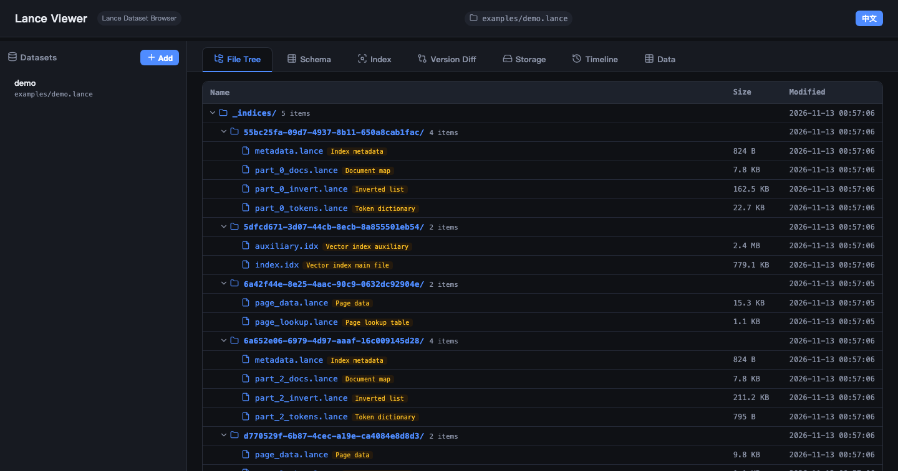
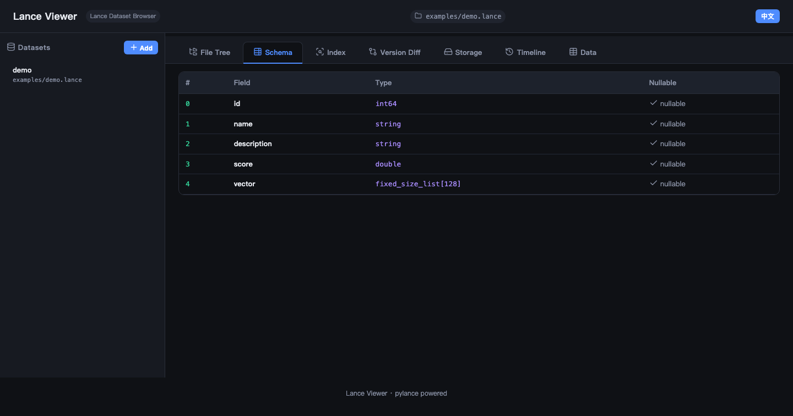
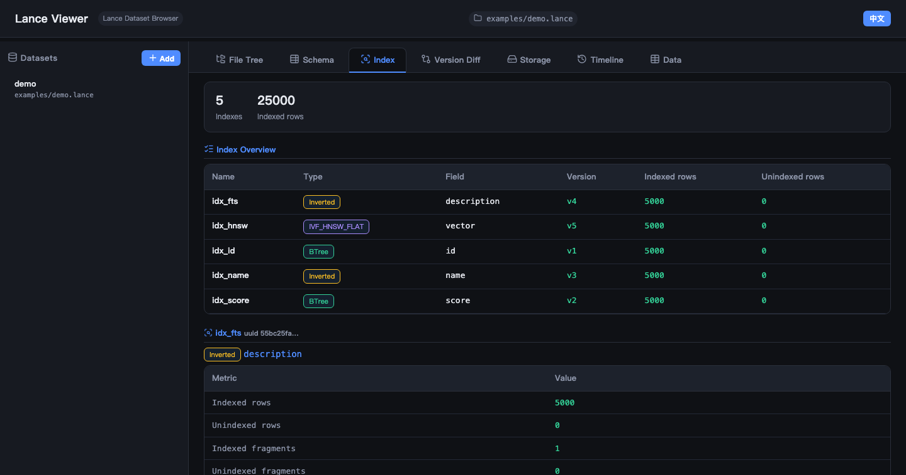
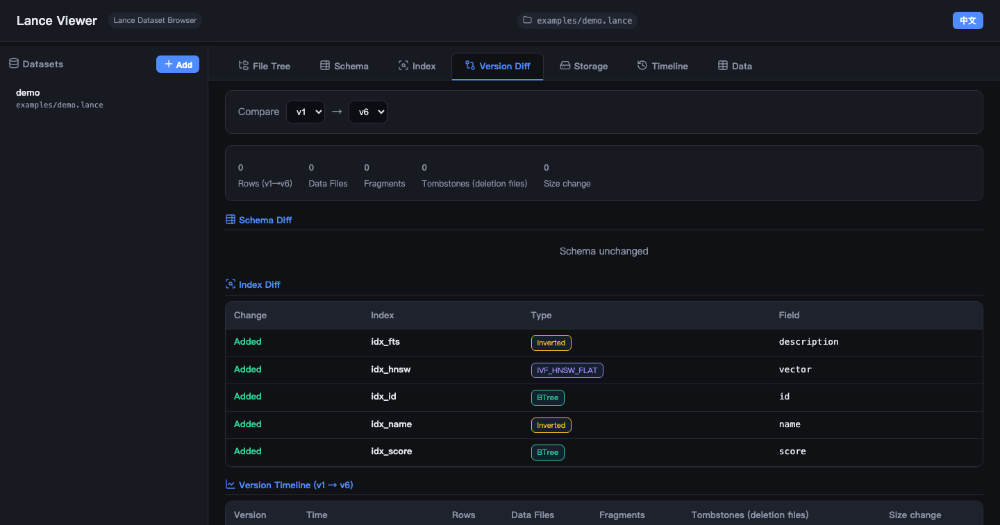
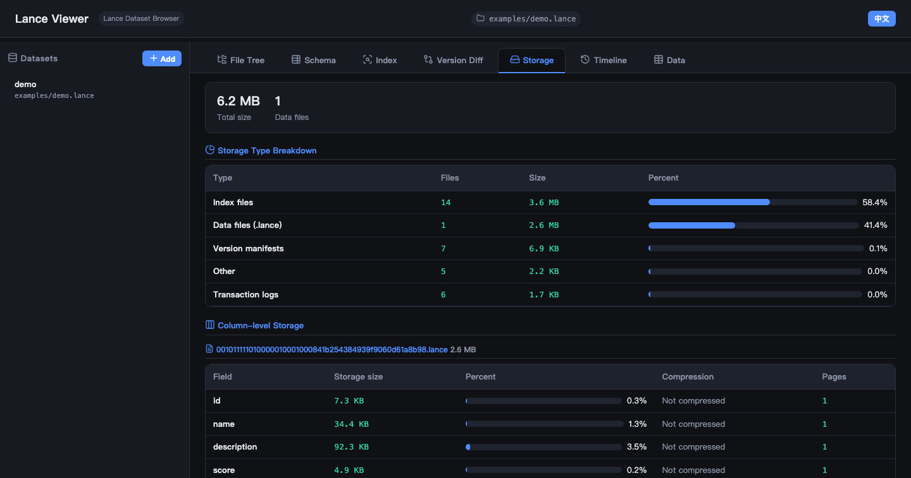
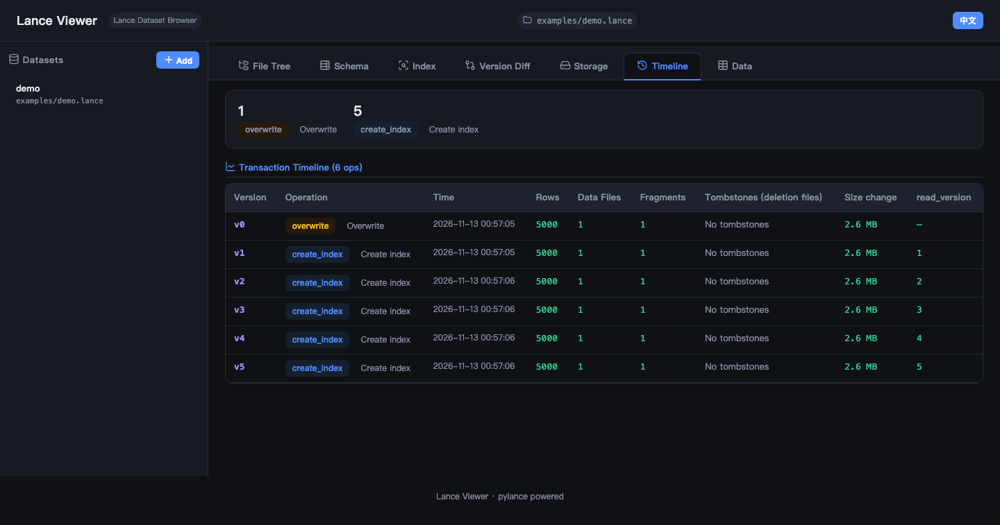
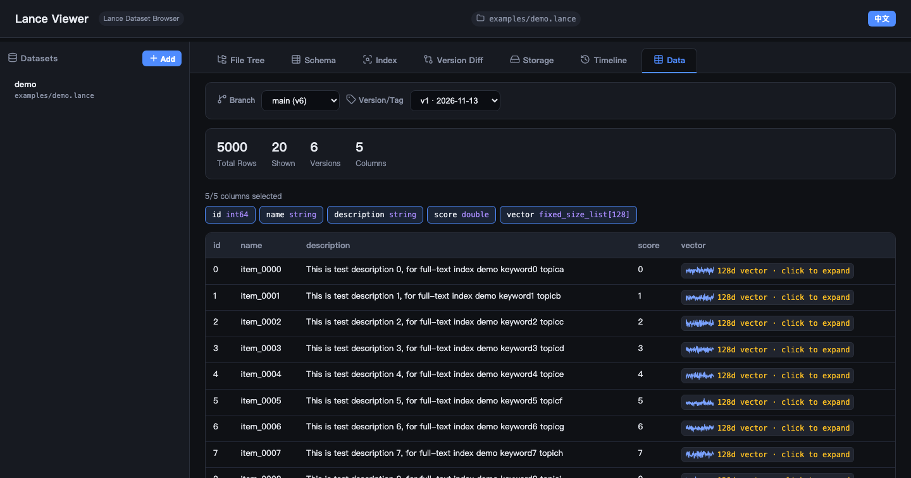

# Lance Viewer — Lance Dataset Visualization Browser

A private Web tool for browsing the internals of any Lance dataset — local files or object storage (S3, etc.). Binds to `127.0.0.1`; data is displayed only on this machine.

## Screenshots

| | |
|---|---|
| 📁 **File Tree** — recursive dataset directory structure | 🗂️ **Schema** — field / type / nullable |
|  |  |
| 🔍 **Index** — vector / scalar index internals | ⏱ **Version Diff** — cross-version comparison |
|  |  |
| 📊 **Storage** — size / compression analysis | 📈 **Transactions** — MVCC operation timeline |
|  |  |
| 📊 **File Content** — decoded .lance table data | |
|  | |

## Features (8 views)

| Tab | Description | Deps |
|---|---|---|
| 📁 File Tree | Recursive dataset tree; click a `.manifest` / `.txn` / `.lance` / `.json` / `.arrow` file to decode it | none |
| 🗂️ Schema | schema (field / type / nullable) | **pylance** |
| 🔍 Index | vector / scalar / full-text index internals and stats | **pylance** |
| ⏱ Version Diff | pick two versions and compare rows / schema / indexes | **pylance** |
| 📊 Storage | size by file type, index overhead | `opendal` for cloud paths |
| 🩺 Health | fragments / tombstones / index coverage / version churn, plus a diagnosis list | **pylance** |
| 📈 Transactions | MVCC transaction timeline, grouped by operation type | **pylance** |
| 📊 Data | table rows with paging, column projection, SQL filter, vector folding, branch/tag/version switching | **pylance** |

Manifest, transaction and data-file decoding are not separate tabs: they open from the file tree.
The generated views cover the manifest protobuf (fields / fragments / index tables), the `.txn`
protobuf (grouped by operation), the `.lance` footer / columns / pages / layout / encoding /
compression, plus raw JSON and Arrow IPC.

## Large Datasets

Views that would otherwise cost one request (or one DOM node) per record are windowed:

| View | Window |
|---|---|
| Transaction timeline | newest 200 transactions, older ones via "load earlier" |
| Storage analysis | the 15 largest data files are decoded; totals still cover every file |
| Manifest / txn JSON tree | 200 children per collection, "show more" for the rest |
| Version dropdown | newest 100 versions; older ones are reachable through the jump box |

### Filtering

The Data tab accepts a Lance/SQL predicate (`id > 100`, `name LIKE 'a%'`, `score IS NULL`). It is
pushed into the scan, so the row total and every page describe the filtered set rather than the
whole table.

## Quick Start

```bash
# 1. Clone / enter the project, create a virtualenv
cd lance-viewer
uv venv .venv

# 2. Install the runtime deps (protobuf, opendal, pyarrow, pylance)
uv pip install --python .venv/bin/python -e .

# 3. Start (use the repo script, default 127.0.0.1:8770)
./start.sh            # or ./start.sh 9000 for a specific port

# 4. Browser
open http://127.0.0.1:8770/
```

> A single `pip install -e .` pulls in the runtime deps (protobuf, opendal, pyarrow, pylance) — no extra install step. Regenerating the proto bindings needs the `proto` extra instead: `pip install -e ".[proto]"`. `start.sh` hard-codes the virtualenv path `.venv`; change the path in the script if you use a different location.

## Architecture

Core parsing is based on protobuf, not on Lance's source implementation; standard `src/` layout, installed via `pip install -e .`.

```
pyproject.toml           # project metadata + dependencies (protobuf/opendal/pyarrow/pylance;
                         #   grpcio-tools only in the `proto` extra, for regenerating bindings)
src/lance_viewer/        # main package (standard src layout, becomes lance_viewer after pip install)
├── server.py            # HTTP routing + dataset CRUD + startup (thin layer, entry point)
├── handlers.py          # API data-fetch functions (grouped by tab)
├── lance_client.py      # pylance client (_open/_storage_options/_is_cloud)
├── util.py              # pure helpers (timestamps/numbers/index-stat folding/file collection)
├── config.py            # dependency availability flags (pylance/pyarrow) + path constants
├── dataset_store.py     # SQLite dataset registry (sidebar management)
├── session_store.py     # open-dataset handle cache (heartbeat + idle eviction)
├── manifest_decoder.py  # manifest/txn protobuf decode
├── datafile_decoder.py  # .lance file footer/pages/encoding parsing
├── static/              # frontend (pure vanilla JS, zero-build)
│   ├── index.html        # page structure (thin shell)
│   ├── favicon.svg       # columnar-store mark (source of the .ico/.png)
│   ├── favicon.ico       # 16/32/48 multi-size, for /favicon.ico requests
│   ├── apple-touch-icon.png
│   ├── css/style.css     # styles
│   └── js/               # frontend modules split by responsibility
│       ├── icons.js      # inlined Lucide SVG icon set (ISC, zero-build)
│       ├── tools.js      # core utilities + global state
│       ├── render.js     # per-tab rendering
│       ├── files.js      # file viewers (manifest/txn/datafile/...)
│       └── sidebar.js    # sidebar + navigation + init
└── protos/              # compiled *_pb2.py + VERSION.json (what they were generated from)
scripts/
├── regen_protos.py      # recompile proto from the lance repo + write protos/VERSION.json
└── create_test_table.py # generate the examples/demo.lance demo dataset
tests/                   # pytest unit/integration tests (decoder/store/http)
                         # + tests/js/ frontend escaping harness (node, run by pytest)
```

**Adding object storage / backend extensions**: cloud-storage URI parsing + storage_options only change in `lance_client.py`; new API functions go in `handlers.py`; routing adds one line in `server.py`.

## Dependency Layers

| Feature | Deps |
|---|---|
| manifest / txn / datafile decode | `protobuf` |
| file tree / storage (cloud paths) | `opendal` |
| deletion files + Arrow tables | `pyarrow` |
| schema / index / version diff / timeline / refs / data table | `pylance` |

All of these are required and installed together with `pip install -e .`. `grpcio-tools` is not one
of them: it is only needed by `scripts/regen_protos.py` (it bundles protoc), so it lives in the
`proto` extra — `pip install -e ".[proto]"` — and costs nothing on a normal install.

## S3-Compatible Storage

Any S3 API provider works through `s3://bucket/path` plus `endpoint`, `region`, `access_key_id`
and `secret_access_key` in the dataset's connection params.

`endpoint` is the **region** endpoint (e.g. `https://s3.us-east-1.amazonaws.com`). The backend
always sends S3 requests with **virtual-hosted addressing**: the bucket is moved into the host
(`https://bucket.s3.us-east-1.amazonaws.com`) and `aws_virtual_hosted_style_request=true` is set.
That is the standard form S3 providers expect — path-style addressing is deprecated on AWS S3 and
rejected outright by some S3-compatible providers. There is nothing to configure per dataset.

`oss://bucket/path` needs no special handling: OpenDAL already defaults to virtual addressing for
OSS (`addressing_style` unset resolves to `virtual`), so the four params above are enough there.

## Upgrading the Lance Version

After Lance upgrades, the in-package protobuf bindings (`src/lance_viewer/protos/`) must be recompiled.
You need a local copy of the Lance source repo (containing `protos/*.proto`); replace `<lance-repo>` below with the actual path.

```bash
# 1. Update Lance source
cd <lance-repo> && git pull

# 2. Install the proto extra (grpcio-tools provides protoc)
cd lance-viewer
.venv/bin/pip install -e ".[proto]"

# 3. Recompile proto (replaces the in-package protos/ and rewrites VERSION.json)
.venv/bin/python scripts/regen_protos.py --lance-repo <lance-repo>

# 4. Restart
./start.sh
```

Normally (stable formats within the `data_storage_version` compatibility matrix) no recompile is needed; only run the script when the format changes.

## Build Provenance

`src/lance_viewer/protos/VERSION.json` records what the checked-in bindings were generated from:
the Lance tag/commit, the protobuf version used for code generation, the hashes of the source
`.proto` files, and the hash of every generated `*_pb2.py`. `scripts/regen_protos.py` writes it on
every run, so a binding that was regenerated but not committed shows up as a mismatch.

```bash
lance-viewer --version                        # or: curl -s http://127.0.0.1:8770/api/version
```

```
lance-viewer 0.1.0
  python 3.13.13, protobuf 7.36.2, pylance 14.0.2
  proto bindings: lance v14.0.2 @ 3f1c2ab9, generated 2026-11-15T06:20:56Z (16 files, protobuf 7.35.1)
```

This is the first thing to check when a page reports `Unknown layout`: if the stamp is older than
the `writer_version` shown in the manifest view, the file is newer than this build — recompile the
bindings rather than debugging the viewer.

## Known Limitations

- **Layout/encoding recognition**: currently identified per the v2_0/v2_1 protos (MiniBlock/FullZip/Constant/Blob). New encoding layouts may need mapping additions after regen; until then a page shows `Unknown layout` plus the `Any` type URL, so a newer file is distinguishable from a broken viewer.
- **Compression algorithms**: recognizes LZ4/ZSTD (the `CompressionScheme` enum). New algorithms need mapping-table additions.
- **Data-file format assumptions**: based on the v2 footer (40 bytes) + magic "LANC". If Lance changes the footer layout, `datafile_decoder.py` must be updated.
- **Indirect encoding**: a page's indirect encoding (encoding stored in another buffer) cannot be shown inline; it is marked as "indirect encoding".

## Privacy & Security

- Binds to `127.0.0.1`, only reachable locally.
- No authentication; do not bind to `0.0.0.0` or expose it publicly (data may contain sensitive memory).
